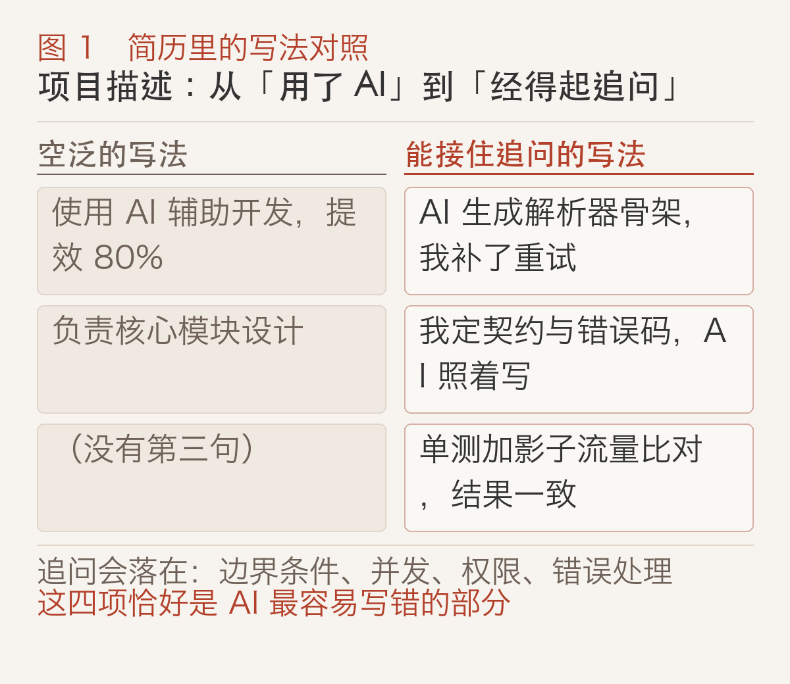
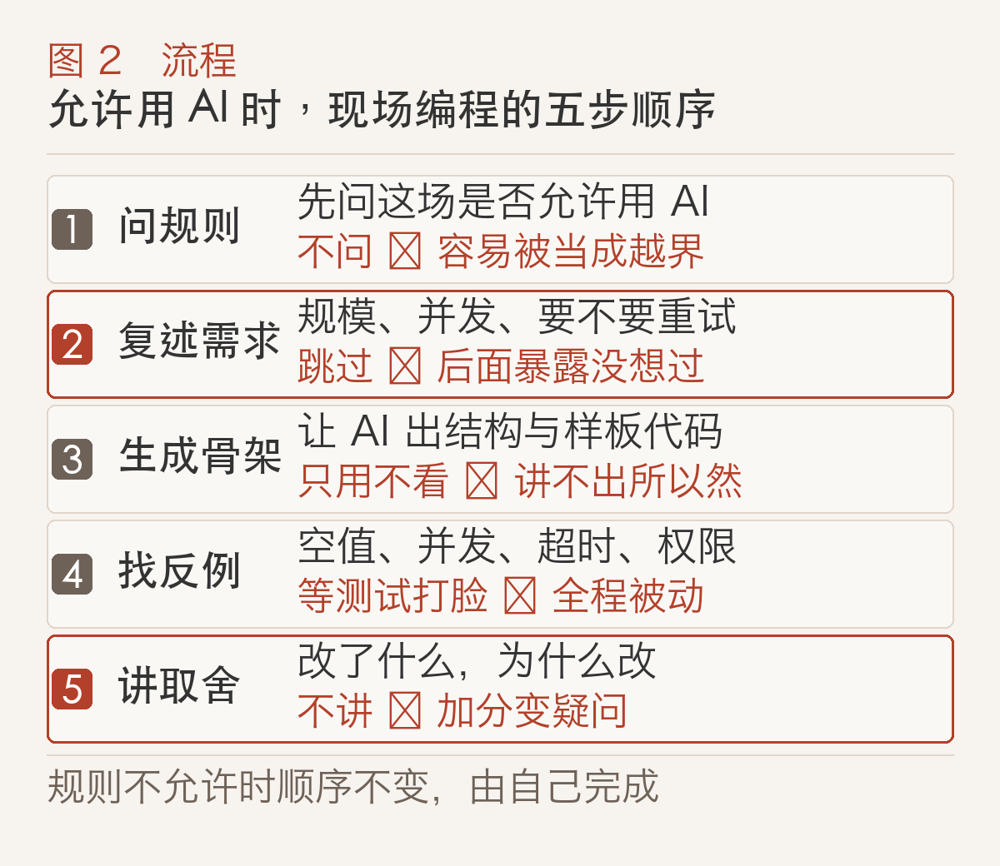
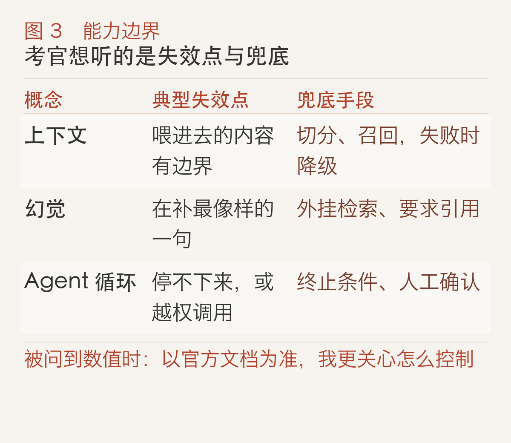

# 会用 AI 写代码，不等于会面试

面试快结束的时候，我常听到同一句话：「平时我用 AI 写，挺快的。」

问下去就卡住了。让它生成的那段代码，边界条件你补了吗？它挑的这个库，你知道为什么还行吗？如果 QPS 涨十倍，这段代码会坏在哪？很多人答不上来，因为在日常开发里，AI 把这些决定替他做完了。

这大概就是现在找工作最难的地方：AI 把打字这一段压缩得很短，面试时间却没有变短。省下来的时间，全进了追问。

## 会用 AI 已经不是加分项，而是默认前提

主流编程工具现在都能读写多个文件、按任务连续改代码，不再是补全一行那么简单，例如 [GitHub Copilot 官方文档](https://docs.github.com/en/copilot)已经按代理式改动的思路组织功能说明，具体能力仍以各产品文档为准。这意味着「我每天用 AI 写代码」这句话已经不带信息量：招聘方默认你会用。

区分点于是换了位置。以前面试很大程度在测「能不能从零写出一个能跑的版本」，因为这项能力便宜、可测、区分度够。现在这一步几秒钟就能完成，它就不再是筛子。

面试官实际在测的东西没变，只是以前被代码本身盖住了：你有没有先问清边界，你的思路有没有被讲出来，你有没有收尾意识，也就是跑一遍、测一遍、想清楚在哪里会崩。这三点和一个人用不用工具关系不大，用得好只会让它们更显眼。

我在模拟面试和真实面试里反复看到同一种落差：用 AI 用得很顺的人，过程可见性往往是最低的。他不解释为什么让模型这么做，也说不清哪几行是自己改的。面试官只能看到一个跑得起来的结果，和一个讲不清楚过程的人。

结论先放在这里：接下来面试要练的是四件事——把需求拆清楚、判断 AI 给的东西对不对、把系统讲明白、和 AI 协作时能讲清自己在做什么。下面一节一件。

## 简历上的项目描述，要让 AI 那部分经得起追问

我对简历的判断很直接：现在有两类描述都没人信。

一类是一个字不提 AI，面试官会怀疑你平时根本不用。另一类是通篇「使用 AI 提效」，数字越大越可疑，因为没人知道那个数字怎么算出来的。

能站住的是第三种：写清 AI 在流程里的位置。它做了哪一段，你做了哪一段，你用什么标准判断它做对了。下面这张表是我建议的改法。

左边那种写法会自己长出问题，而且每个问题都答不上来。右边的写法反过来，它主动交代了分工，面试官顺着问下去，问到的正是你准备过的部分。

具体做法是三句话：

1. **它做了什么**：说清交给 AI 的那一段的输入输出，别写「提效」。
2. **你做了什么**：契约、数据结构、错误处理、权限这些通常是人定的，写出来。
3. **你怎么验证**：测试、对比、观测，任选其一但要说得出细节。

第三句通常是短板，也是最值得补的。AI 写代码的错误很少出现在主流程，集中在边界条件、并发、权限和错误处理上。这些恰好是写项目描述时绕不过去、也最能体现判断力的部分。

再往下一层，我建议你准备两句实话：「这段我没动手写，但我改了三处，分别是因为……」以及「这块我没验证到，我会这样补」。前一句证明你真的在做决定，后一句证明你知道边界在哪。面试官对第二句的容忍度比你想的高，但没人能接受「我看了一遍，感觉没问题」。

## 现场编程：用不用 AI 是规则题，用了能不能讲清才是能力题

这一节篇幅最长，因为它是面试里权重很高的一段，争议也集中在这里。

先说规则。面试里用不用 AI 不是道德题，是规则题：有的团队明确开放，有的明确禁止，有的没说。**开口问一句「这场允许用 AI 辅助吗」，本身就是第一道题**。问的行为说明你会先确认边界，这比闷头开写加分。

规则允许的时候，按下面五步走。

第 2 步最容易被跳过，也最值钱。把题面用自己的话复述一遍，同时问出三件事：数据规模多大、并发不并发、失败时要不要重试。面试官经常故意留白，看你会不会问。

举个示例题，实现一个限流器。AI 大概率先给你一个单机版的令牌桶，跑得通，测试也过。如果你不问分布式那一层，前面写得越顺，后面越暴露你没想过。

第 4 步是主动去找反例，不是等测试来打脸。针对 AI 生成的代码，我固定问自己四个问题：空值和空集合会怎样？并发访问同一份状态会怎样？依赖服务超时或返回错误呢？权限不够的时候读到的是空还是报错？这四个方向覆盖了大部分真实故障。

第 5 步讲取舍，三十秒就够：我让 AI 生成骨架，自己改了哪几处，为什么改，还剩什么没解决。能把这段说完，工具就从风险变成了加分项；说不完，工具帮的忙会变成疑问。

有人会说：不用 AI 才显得实诚。我不这么看。实诚指的是用了也讲清楚，不是假装工具不存在。反过来也一样，如果你真觉得这题手写更快，那就手写，然后说清为什么不借工具，这同样是一个可被评价的决定。

规则不允许的时候，顺序不变，只是每一步都由你自己完成，慢一点而已。练的是同一套能力，所以平时练习时不该只练「用 AI 那次」。

## 讲 LLM 的能力边界，讲失效点比背名词更管用

面试里问 RAG、问 Agent、问上下文，我想听的从来不是定义。定义在文档里就有。

我想听的是：这东西在什么条件下会不灵，你打算怎么兜底。下面这张表是我会追问的三组问题。

拿上下文举例。上下文窗口能装多少，按模型和版本分别规定，各厂商文档会自己更新，比如 [OpenAI API 文档](https://developers.openai.com/api/docs/models)里就是按模型分列参数的，所以背一个数字没有意义。真正的问题是：长不等于相关。你塞进去的五十页文档里，模型未必用到了你需要的那两段。讲清你怎么切分、怎么召回、怎么处理召回失败，比说出一个窗口大小有用得多。

幻觉这个词被用滥了，但机制值得说清：模型在生成最像样的下一句话，不是先查证再回答。所以涉及事实的环节必须外挂校验，查库、对账、要求引用来源都算。能不能意识到这一点，直接决定你设计的是能上线的系统，还是能演示的系统。

Agent 的难点不在模型多聪明，在工程约束：工具怎么设计，什么时候停，失败了重试几次，哪些动作需要人工确认。说得出权限边界的人，通常是真的接过这类系统。

这一节不需要你记任何数字。被问到数值就说「以官方文档为准，我更关心怎么控制」，然后接上机制。这个回答比背一个可能已经过期的数字体面得多。

## 系统设计失分，多半是只有方案没有取舍

系统设计环节最常见的失分，不是方案不对，而是只有方案。

列出五个组件这件事现在很廉价，面试官自己让模型列一遍也能得到差不多的清单。区分点因此往下走了一层：你为什么选这个而不是那个，代价是什么，什么信号出现时你会改回来。

我给自己的固定句式是四段：

1. **先说约束**：数据量级、读写比例、延迟要求、可用性目标，缺的当场问。
2. **给方案**：一句话讲清主链路，不要先铺开所有细节。
3. **说代价**：这个选择的成本落在哪，是复杂度、机器成本、还是一致性。
4. **说触发改动的信号**：什么指标变了，我会换方案。

第四段很少有人练，它恰恰最能证明你做过真实决策。同样的四段可以直接用在 AI 功能上：要不要上 RAG，答案取决于你的知识是不是经常变、答案是否必须可追溯。

AI 生成的设计方案有一个稳定盲区：非功能需求。并发、权限、错误处理、降级，它经常一笔带过，因为这些在文本里不显眼。你把这四样补上，方案就从不完整变得完整。

## 反问环节，问流程比问福利更能看出这家公司

反问是全场少数由你主导的环节，也是验证「这家公司是真在用 AI，还是只写在 JD 里」的机会。

别问你们用不用 AI。工具能力是公开信息，问这个等于没问，对方怎么答都行。要问就问到判断标准上：

- 团队里 AI 生成的代码怎么评审？Review 时重点看什么？
- 有没有明确规定哪些代码不允许 AI 生成？为什么是这几类？
- 线上故障复盘里，AI 相关的坑通常出在哪一步？

这三个问题的共同点是：答案里必须包含取舍。含糊的团队说不出具体标准，真在用 AI 的团队会顺口讲出一个流程。

## 两周准备清单，从今晚的一条提交记录开始

前面讲的是为什么，这一节是做什么。两周不宽裕，只做四类动作，每天三十到四十五分钟。

| 时间 | 练什么 | 产出 |
|:---|:---|:---|
| 第 1–3 天 | 翻自己最近三个月 AI 参与最多的提交 | 三条可讲的项目故事 |
| 第 4–6 天 | 重写一条项目描述，按「它做什么 / 我做什么 / 怎么验证」 | 一版经得起追问的简历 |
| 第 7–10 天 | 模拟一次允许用 AI 的现场编程，按五步走并录音 | 一次自己的流程复盘 |
| 第 11–14 天 | 把一个 AI 相关系统讲给不熟悉的人听懂 | 一段三分钟的边界与兜底说明 |

如果某类追问答不上来，那就是你的练习重点，回到对应那一节重读。

今晚可以做的只有一件事：打开你最近一个项目的提交记录，找三条 AI 参与最多的改动，每条写一句话——AI 写了什么、我改了什么、我怎么知道改对了。写着写着你会发现，第一条就写不利索。写不利索的那一句，正是两周里最该补的地方。
